# 1. Descripción del problema

Un apostador juega repetidamente contra una casa que tiene ventaja matemática. En la ruleta europea, apostar a rojo/negro gana con probabilidad $p=18/37\approx0.4865$ (pago 1:1); en la americana, $p=18/38\approx0.4737$. La ventaja de la casa por unidad apostada es $1-2p$: 2.70 % y 5.26 % respectivamente.

Los apostadores creen con frecuencia que una *estrategia de apuesta* (Martingala, Kelly, etc.) puede vencer a la casa, y en las redes sociales se difunden los casos de éxito y casi nunca los de ruina. Este proyecto estudia cinco preguntas:

1. ¿Con qué probabilidad un apostador llega a la ruina antes de alcanzar su meta, según su estrategia?
2. ¿Cuánto tarda en promedio en terminar?
3. ¿Qué tan bien coincide la simulación con la solución analítica de la cadena de Markov?
4. ¿Alguna estrategia vence realmente a la casa, o solo cambia *cómo* se pierde?
5. Si los apostadores copian a sus vecinos en una red, ¿qué estrategias se propagan y por qué?

El tema tiene aplicación real: es la base matemática de la gestión de riesgo en casinos y apuestas en línea, de la teoría de la ruina en seguros y de la gestión de capital en trading; y el tercer bloque conecta con la difusión de información financiera engañosa en redes sociales.

# 2. Análisis

**Técnicas del curso utilizadas.** (i) *Espacio de estados*: el capital es una cadena de Markov con dos estados absorbentes. (ii) *Modelado basado en agentes (ABM)*: cada apostador es un agente con capital, meta, estrategia e historial. (iii) *Redes*: los agentes son nodos de redes Erdős–Rényi, Watts–Strogatz y Barabási–Albert y aprenden socialmente.

**Resultado teórico guía.** Para cualquier estrategia con tiempo de parada acotado, el teorema de parada opcional (identidad de Wald) da $E[\Delta \text{capital}]=(2p-1)\,E[\text{total apostado}]$. Si $p<1/2$, ninguna estrategia puede lograr ganancia esperada positiva; solo puede cambiar *cuánto* se apuesta y la *forma* de la distribución. Esta predicción se verifica numéricamente en la sección 6.

**Supuestos y limitaciones del modelo.** La ruleta no tiene memoria (rondas independientes), no hay costos de transacción ni impuestos, el pago es exactamente 1:1, el apostador no puede apostar fracciones menores a una unidad (se considera arruinado con menos de 1 unidad), y el capital de la casa es suficiente (salvo en la extensión de límite de mesa).

# 3. Propuesta de solución

Se construyó un modelo en tres capas, cada una validada contra la anterior:

- **Parte 1 – Markov exacto**: matriz de transición, forma canónica, matriz fundamental y comparación con fórmulas cerradas.
- **Parte 2 – ABM Monte Carlo**: ocho estrategias; la apuesta fija debe reproducir la Parte 1; la Martingala con límite de mesa se valida contra una cadena de Markov exacta ampliada.
- **Parte 3 – ABM en red**: dinámica de imitación sobre tres topologías, con experimentos de semilla, influencer, métricas de red e intervenciones.

# 4. Descripción de la solución

## 4.1 Cadena de Markov (Parte 1)

Estados $\{0,1,\dots,N\}$; $0$ (ruina) y $N$ (meta) absorbentes. $P_{i,i+1}=p$, $P_{i,i-1}=q=1-p$, $P_{00}=P_{NN}=1$. Para $N=6$, $p=18/37$:

$$P=\begin{pmatrix}1&0&0&0&0&0&0\\ q&0&p&0&0&0&0\\ 0&q&0&p&0&0&0\\ 0&0&q&0&p&0&0\\ 0&0&0&q&0&p&0\\ 0&0&0&0&q&0&p\\ 0&0&0&0&0&0&1\end{pmatrix}$$

Reordenando (transitorios primero) queda la forma canónica $\begin{pmatrix}Q&R\\0&I\end{pmatrix}$. La matriz fundamental $F=(I-Q)^{-1}$ da en $F_{ij}$ el número esperado de visitas a $j$ partiendo de $i$; $t=F\mathbf 1$ es el tiempo esperado hasta la absorción y $B=FR$ las probabilidades de absorción en $0$ y $N$. Las fórmulas clásicas, con $r=q/p$:

$$P(\text{ruina}\mid i)=\frac{r^i-r^N}{1-r^N}\ (p\neq\tfrac12),\qquad 1-\frac iN\ (p=\tfrac12),\qquad E[T]=i(N-i)\ (p=\tfrac12).$$

Las matrices completas para $N=6$ están en `results/matriz_P_N6.txt`.

**Variante sin meta.** Con solo ruina absorbente y $p\le 1/2$ la ruina es segura. El comportamiento a largo plazo se describe con la distribución cuasi-estacionaria (autovector izquierdo dominante de $Q$) y la tasa de decaimiento $\lambda$ de la supervivencia ($\approx\lambda^n$). Si $p>1/2$, $P(\text{ruina})=r^i<1$.

**Extensión: límite de mesa.** Se amplía el espacio de estados a (capital, racha perdedora) para la Martingala con apuesta $b=\min(2^k,L,c)$; se resuelve el sistema lineal exacto para ruina y duración (`martingala_limite_mesa`).

## 4.2 Agentes (Parte 2)

Cada agente tiene capital, capital inicial, meta, estrategia, rachas ganadora y perdedora, capital máximo (pico), pérdidas acumuladas y total apostado. Estrategias: **apuesta fija**; **Martingala** (duplica tras perder, limitada por capital y mesa); **Paroli** (duplica tras ganar, retira tras 3); **porcentaje fijo** del capital; **Kelly** ($f^*=\max(p-q,0)$, con fracción ajustable); **falacia del jugador** ($b=1+\text{racha perdedora}$); **persecución de pérdidas** ($b=1+0.5\times$ caída desde el pico); y **no apostar**. Todas respetan $b\le$ capital y $b\le$ límite de mesa. La simulación está vectorizada en NumPy (decenas de miles de agentes a la vez).

## 4.3 Red (Parte 3)

500 agentes, grado medio 6, tres topologías con igual número de aristas. Cada *época* (25 rondas) cada agente vivo observa a sus vecinos vivos; si el que más ganó en la época (en unidades de capital inicial) ganó más que él, lo imita con probabilidad 0.3. Los arruinados **no son visibles** (sesgo de supervivencia). Seis estrategias iniciales equiprobables (fija, Martingala, Paroli, 5 %, persecución, no apostar), capital 100, base 1, límite de mesa 64, sin meta (se observa 1000 rondas). Un *influencer* publica solo su mejor resultado de las últimas 5 épocas. Un *informante* es un hub que no apuesta y convence a sus vecinos de dejar de apostar con probabilidad 0.3 por época.

# 5. Herramientas aplicadas

Python 3.13, NumPy, Pandas, SciPy, Matplotlib, NetworkX. **Desviación respecto a lo sugerido:** no se usó Mesa; se programó un ABM propio con arreglos NumPy porque la Parte 2 requiere decenas de miles de agentes × miles de rondas (Mesa, que itera agente por agente en Python, sería órdenes de magnitud más lento). El modelo conserva la estructura de agente (estado propio, historial, estrategia). Todo el código está en `src/` y `experiments/`, con semillas fijas (dependencias en `requirements.txt`).

## 5.0 Herramientas no vistas en clase

**(a) Distribución cuasi-estacionaria (Yaglom).** Sin meta y con $p\le 1/2$, la ruina es segura, así que no existe distribución estacionaria sobre los estados transitorios: toda la masa termina en 0. Aun así, el apostador que *todavía no se arruina* tiene una distribución de capital que se estabiliza en forma. Sea $Q$ la submatriz de estados transitorios ($1,\dots,C$). Si $Q$ es irreducible y aperiódica en el sentido relevante, el teorema de Perron–Frobenius da un valor propio dominante $\lambda\in(0,1)$ con vector propio izquierdo $\nu>0$, $\nu Q=\lambda\nu$, normalizado a $\sum\nu_i=1$. Entonces
$$P_i(X_n=j\mid T>n)\to\nu_j,\qquad P_i(T>n)\sim c\,\lambda^n .$$
$\nu$ es la distribución cuasi-estacionaria: la forma del capital condicionada a seguir vivo; $\lambda$ es la tasa de decaimiento de la supervivencia y $\ln 2/(-\ln\lambda)$ su semivida. Se calcula con `numpy.linalg.eig` sobre $Q^\top$ (`distribucion_cuasi_estacionaria` en `src/markov.py`); como el espacio es finito se trunca en un capital máximo $C$ con frontera reflejante. Resultado: $\lambda=0.99934$ en la europea y $0.99826$ en la americana. Referencia: Collet, Martínez y San Martín (2013).

**(b) Criterio de Kelly.** Si en cada ronda se apuesta una fracción $f$ del capital y se gana con probabilidad $p$ (pago 1:1), el capital tras $n$ rondas con $W$ victorias es $X_n=X_0(1+f)^{W}(1-f)^{n-W}$. Por la ley de los grandes números, la tasa de crecimiento logarítmico por ronda converge a
$$g(f)=p\ln(1+f)+q\ln(1-f).$$
Derivando, $g'(f)=\frac{p}{1+f}-\frac{q}{1-f}=0$ da $f^*=p-q=2p-1$. Como $g$ es cóncava, $f^*$ es el máximo; además $g(f)>0$ solo para $f<f_c\approx 2f^*$ y $g<0$ más allá, es decir, apostar el doble de Kelly ya no crece y más allá arruina casi seguro. Si $p\le 1/2$, $f^*\le 0$: la recomendación es no apostar (en el código `f = max(2p-1, 0)`). Esto explica por qué el medio Kelly retiene $g(f^*/2)/g(f^*)\approx 75\%$ del crecimiento con mucha menos varianza (sección 6.4). Referencias: Kelly (1956), Thorp (2006).

**(c) Identidad de Wald.** Para cualquier estrategia con tiempo de parada acotado, $E[\Delta\text{capital}]=(2p-1)\,E[\text{total apostado}]$. Es el resultado que ordena todo el trabajo: con $p<1/2$ ninguna regla de apuesta (que solo use información pasada) puede volver positivo el valor esperado; solo modifica *cuánto* se apuesta.

## 5.1 Uso de IA generativa

Se usó Claude Code (modelo Sonnet 5.5) como asistente de programación y redacción. Historial resumido de los prompts y la evaluación crítica:

| # | Prompt (resumen) | Resultado | Evaluación |
|---|---|---|---|
| 1 | Entregar la guía del proyecto y la descripción de "La ruina del jugador", pidiendo realizar y completar el proyecto. | Plan de tres partes, estructura del repositorio, código de las tres capas, experimentos, informe y diapositivas. | Útil por velocidad. Se verificó que Parte 1 coincidiera con las fórmulas (error < 1e-10) antes de confiar en el resto. |
| 2 | (Iteración) Primera comparación de estrategias. | Con 2000 rondas máximo, la apuesta fija quedaba "sin terminar" en 28 % de los agentes, lo que hacía injusta la comparación con la Martingala. | **Error detectado al revisar las tablas**: se subió el horizonte a 30 000 rondas. |
| 3 | (Iteración) Experimento de Kelly con meta 400. | La gráfica era inútil: todos los agentes terminaban en la meta y los histogramas eran barras idénticas. | **Diseño erróneo**: se rehízo con horizonte fijo (2000 rondas, sin meta), donde sí aparece la curva clásica de Kelly. |
| 4 | (Iteración) Intervención de límite de mesa en la red. | Reducir el límite de 64 a 8 baja la ruina pero *no* sube la riqueza media. | Inicialmente parecía un error; se comprobó con el total apostado (sube con límite 8) y coincide con la identidad de Wald. Se reporta tal cual. |
| 5 | Selección del vecino imitado y semilla en nodos aislados. | La "hoja" en ER eligía nodos de grado 0 (no pueden difundir nada). | Corregido: la hoja es el nodo de grado mínimo $\ge1$. |

La IA no sustituye la comprensión: las fórmulas, el diseño de la dinámica de imitación y la interpretación se revisaron manualmente, y los resultados que contradecían la intuición (puntos 3–4) se investigaron antes de aceptarlos. 

# 6. Resultados

## 6.1 Markov exacto vs fórmulas (preguntas 1–3)

Para $N=50$ y capital inicial $i=25$ (`results/parte1_markov_vs_formula.csv`); $F R$ y $F\mathbf 1$ coinciden con las fórmulas con error máximo $<10^{-10}$ en todos los estados:

| Juego | $P(\text{ruina})$ | $P(\text{meta})$ | Rondas esperadas |
|---|---|---|---|
| Ruleta europea ($p=18/37$) | 0.7944 | 0.2056 | 544.6 |
| Ruleta americana ($p=18/38$) | 0.9330 | 0.0670 | 411.4 |
| Justo ($p=0.5$) | 0.5000 | 0.5000 | 625.0 |
| Ventaja del jugador ($p=0.52$) | 0.1191 | 0.8809 | 476.1 |

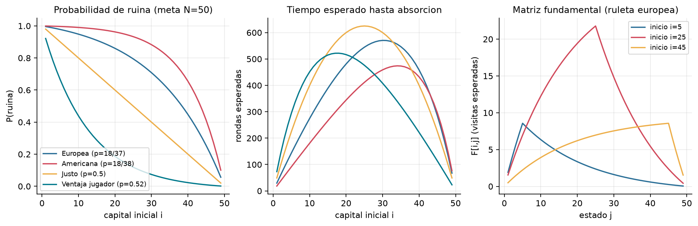

**Sin meta.** Con $p<1/2$ la ruina es segura; la supervivencia decae como $\lambda^n$ con $\lambda=0.99934$ (europea, semivida ≈ 1056 rondas) y $\lambda=0.99826$ (americana, ≈ 397 rondas): la ruleta americana se "come" al apostador 2.7 veces más rápido. Partiendo con 20 unidades, la ruina acumulada a 4000 rondas es 98.2 % (europea) y 99.98 % (americana). Con $p=0.52$ la ruina asintótica es $(q/p)^{20}=0.449$ (la gráfica truncada a 4000 rondas, con tope reflejante en 100, aún no alcanza ese valor).

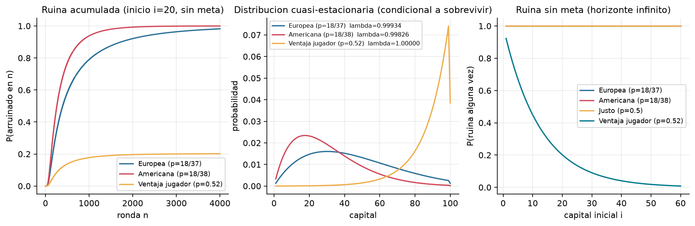

**Límite de mesa (extensión).** Para la Martingala de 100 a 200 unidades en ruleta europea, la ruina exacta es 0.963 con límite 2, 0.769 con 8, 0.673 con 16, 0.610 con 32 y 0.579 con $\ge 64$; el límite aumenta la ruina porque impide recuperar. Con $p=0.52$ ocurre lo contrario (0.0085 con límite 2 frente a 0.389 sin límite), porque en un juego favorable apostar poco es mejor.

## 6.2 Validación de la simulación (pregunta 3)

20 000 agentes de apuesta fija por capital inicial ($N=50$): error absoluto máximo en $P(\text{ruina})$ de 0.0115 y 95.8 % de los puntos dentro del IC de 95 % (esperado ≈ 95 %); error relativo máximo en la duración de 3.1 %. La Martingala con límite de mesa también concuerda con la cadena exacta ampliada (límite 100: ruina 0.5793 exacta vs 0.5750 simulada; duración 158.2 vs 158.5).

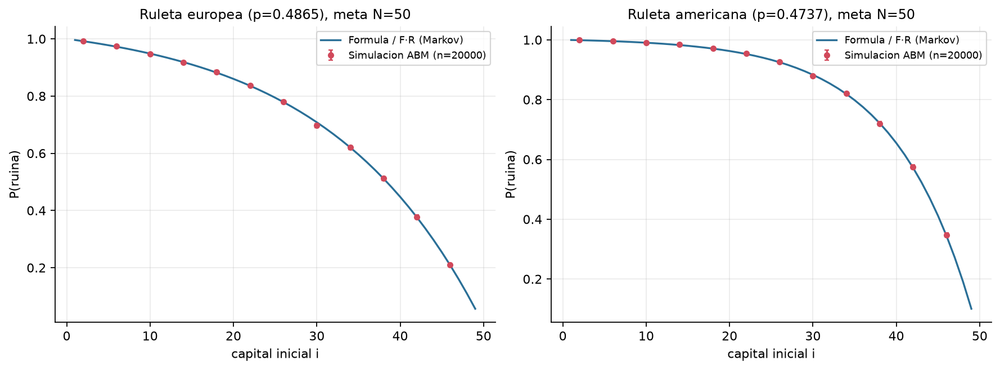

## 6.3 Estrategias en ruleta europea (preguntas 1, 2, 4)

Capital 100, meta 200, límite de mesa 100, 20 000 agentes (`results/parte2_estrategias_europea.csv`):

| Estrategia | $P(\text{ruina})$ | $P(\text{meta})$ | Capital medio | Rondas medias | Pérdida / unidad apostada |
|---|---|---|---|---|---|
| Apuesta fija | 0.996 | 0.004 | 0.9 | 3690 | 0.027 |
| Martingala | 0.577 | 0.423 | 84.5 | 159 | 0.026 |
| Paroli | 0.916 | 0.084 | 16.9 | 1790 | 0.027 |
| Porcentaje 5 % | 0.771 | 0.229 | 47.5 | 1314 | 0.027 |
| Falacia del jugador | 0.870 | 0.130 | 26.0 | 1353 | 0.027 |
| Persecución de pérdidas | 0.636 | 0.364 | 72.9 | 286 | 0.027 |
| Kelly | no apuesta | — | 100 | 0 | — |

La columna final es el resultado central: **la pérdida esperada por unidad apostada es 0.027 = 1−2p en todas las estrategias** (0.053 en la ruleta americana). La Martingala "gana" más seguido (42 % llega a la meta) pero solo porque apuesta mucho menos en total (587 vs 3690 unidades); su capital medio sigue siendo inferior al inicial. Esto es consistente con que las apuestas grandes ("juego audaz") maximizan la probabilidad de alcanzar una meta en un juego desfavorable, pero no cambian el valor esperado.

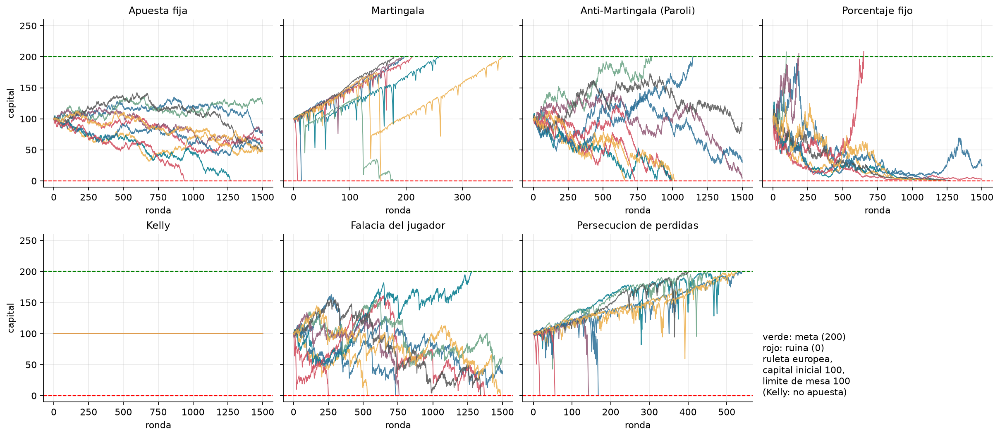

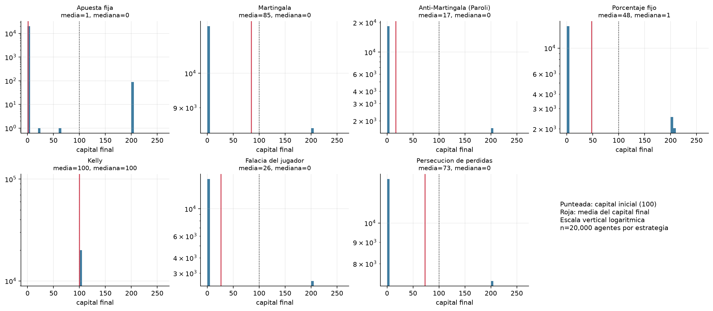

**Efecto de la varianza.** Con meta de solo +10 y sin límite de mesa, la Martingala llega a la meta en 88.9 % de los casos (apuesta fija: 58.0 %), pero el 11.1 % restante lo pierde todo; la media final (97.8) queda por debajo de 100 y la distribución es una masa en 110 con una cola de pérdidas totales: muchas victorias pequeñas, pocas pérdidas enormes.

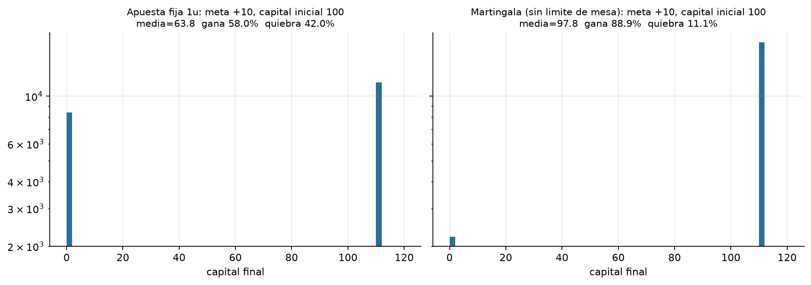

## 6.4 Kelly con ventaja positiva ($p=0.52$)

Con $p=0.52$, $f^*=p-q=4\%$. En 2000 rondas, el capital mediano (inicio 100) es 201, 332, 496, 448, 99 y 1 para fracciones 0.25, 0.5, 1, 1.25, 2 y 3 veces Kelly, y la probabilidad de ruina pasa de 0 (hasta Kelly) a 0.2 (doble Kelly) y 0.70 (triple). El crecimiento logarítmico es máximo en $f^*$ y se vuelve negativo a partir de 2$f^*$; el **medio Kelly** conserva ≈75 % del crecimiento (0.0006 vs 0.0008 por ronda) con ruina ≈0. Cabe notar que la *media* aritmética sigue aumentando con la sobreapuesta (por unos pocos agentes extremadamente afortunados), lo que ilustra por qué la media engaña y la mediana/crecimiento logarítmico importan. En la ruleta ($p<1/2$), Kelly dicta no apostar.

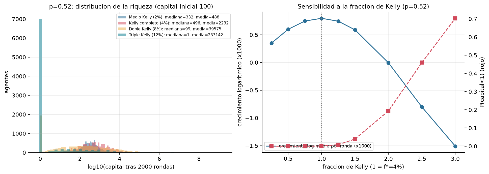

## 6.5 La casa

La ganancia de la casa por unidad apostada converge a 1−2p = 0.027 con desviación $\propto 1/\sqrt{n}$: con $10^5$ apuestas la desviación es 0.003, un décimo de la ventaja. Con 10 000 apostadores de apuesta fija la casa gana en promedio 99 unidades por agente (Martingala: 14.6) (`results/parte2_casa.csv`).

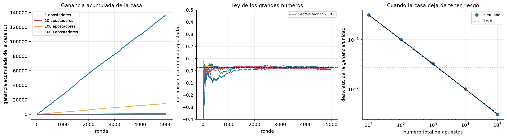

## 6.6 Sensibilidad

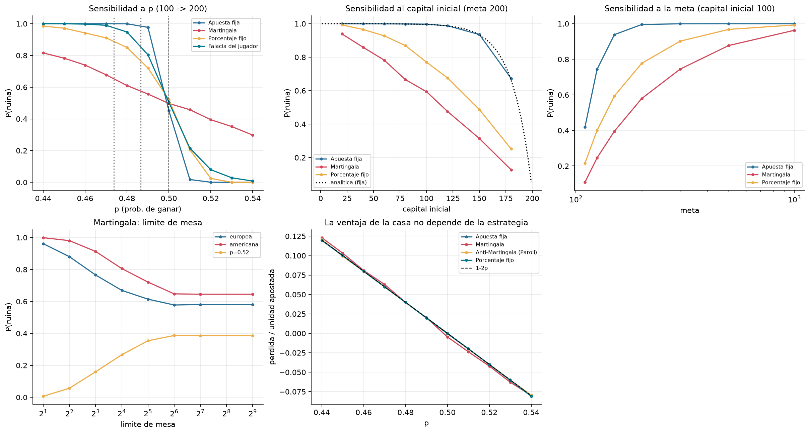

- **$p$**: la ruina cambia de forma abrupta alrededor de $p=0.5$ para apuesta fija y porcentaje; la Martingala (audaz) es menos sensible, mejor que la fija si $p<0.5$ y peor si $p>0.5$.
- **Capital inicial y meta**: más capital inicial y metas más cercanas reducen la ruina; metas grandes la llevan a ≈1 para todas las estrategias.
- **Límite de mesa**: en juegos desfavorables, más límite reduce la ruina de la Martingala hasta que deja de ser restrictivo (≥ 64).
- **Pérdida por unidad apostada** vs $p$: las curvas de todas las estrategias coinciden con $1-2p$.

## 6.7 Red social (pregunta 5)

Promedio de 100 réplicas por topología (`results/parte3_proporciones.csv`). Todas parten con ≈16.7 % de cada estrategia:

| Topología | Martingala final | Ruina final con imitación | Ruina sin imitación | Capital medio con / sin imitación |
|---|---|---|---|---|
| Erdős–Rényi | 79 % | 76.3 % | 34.5 % | 46.6 / 63.6 |
| Watts–Strogatz | 74 % | 73.9 % | 34.6 % | 49.0 / 63.4 |
| Barabási–Albert | 64 % | 67.3 % | 34.5 % | 42.4 / 62.9 |

Hallazgo principal: **la Martingala se propaga**, en las tres topologías, porque en una época de 25 rondas casi siempre muestra una ganancia pequeña mientras sus pérdidas catastróficas son raras y, cuando ocurren, el agente arruinado deja de ser visible. La imitación **duplica la ruina** (de ≈35 % a 67–76 %) y baja el capital medio. La estrategia que de verdad no pierde ("no apostar") desaparece.

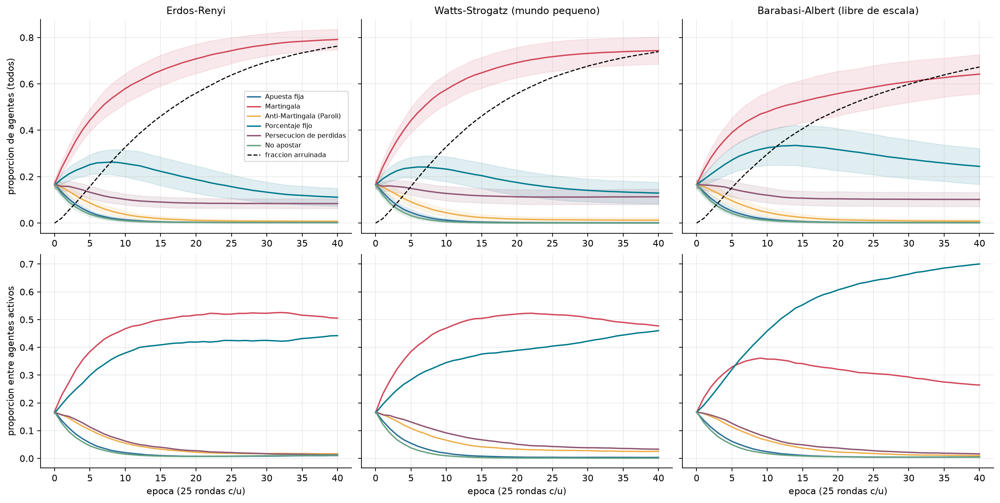

En la fila inferior se aprecia el sesgo de supervivencia: entre los *sobrevivientes* la Martingala cae en la red libre de escala porque sus adoptantes se arruinan; el porcentaje fijo (que decae lento) pasa a dominar a los activos.

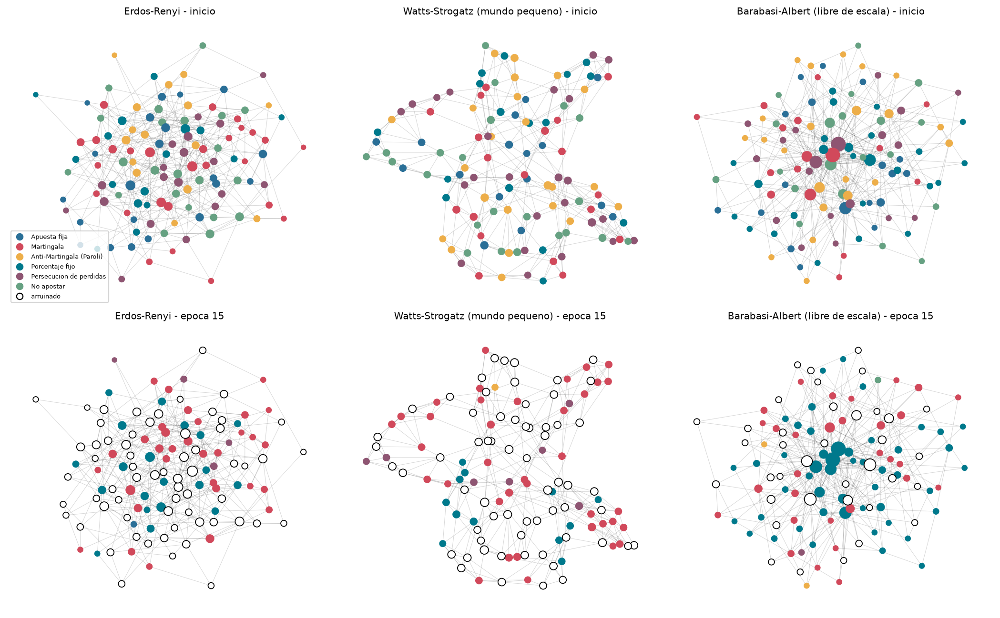

**Semilla y grado.** Un solo agente Martingala entre agentes de apuesta fija (`results/parte3_semilla.csv`): el tiempo promedio para llegar a 25 % de la red es 12.5 épocas desde un hub en ER (27.5 desde un nodo de grado 1), 12.6 desde el hub en BA (17.2 desde una hoja) y 18.6 vs 22.8 en WS. La red libre de escala y la aleatoria difunden más rápido desde los hubs; el mundo pequeño con alto agrupamiento es el más lento, posiblemente porque su alto agrupamiento hace que los vecinos compartan vecinos y haya menos caminos nuevos (explicación plausible, no se probó aisladamente).

**Influencer.** Un hub BA que *presume* su mejor resultado reciente lleva la Martingala a 81.4 % (vs 75.5 % si informa honestamente) y llega a 25 % en 10.6 épocas (vs 12.6): ocultar las pérdidas hace más eficaz la difusión.

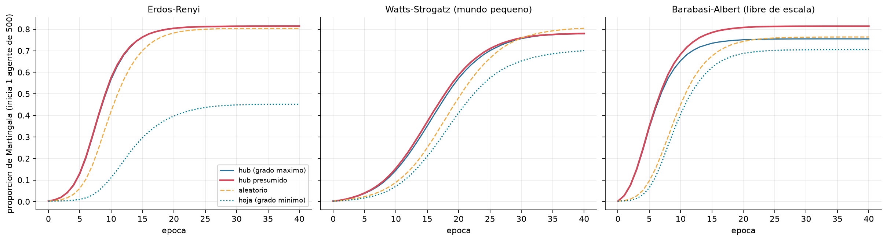

**Métricas de red y riqueza final.** La relación entre posición y riqueza final es débil: correlaciones de Spearman de −0.05 a 0.03 para grado, intermediación, cercanía y agrupamiento. Los hubs tienden a quedar ligeramente peor (explicación plausible, no probada: ven más vecinos, hay más probabilidad de que alguno presente un resultado llamativo y adoptan antes la Martingala). Existe una señal pequeña de comunidad (ρ≈0.10 en ER, 0.08 en BA): la riqueza media de la comunidad se asocia con la propia, porque los vecinos comparten estrategia. Modularidad: 0.39 (ER), 0.73 (WS), 0.38 (BA). **En una red, quién eres importa menos que qué estrategia se difunde en tu entorno.**

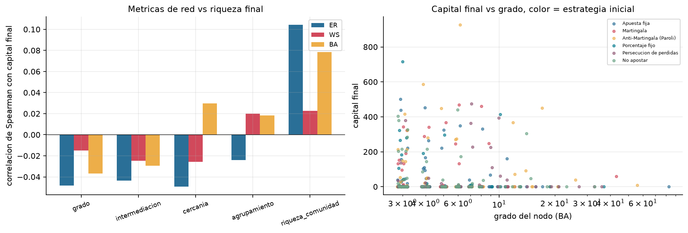

**Intervenciones** (`results/parte3_intervenciones.csv`, 60 réplicas):

| Intervención | Ruina final (ER / WS / BA) | Capital medio (ER / WS / BA) |
|---|---|---|
| Base (límite 64) | 76 / 74 / 67 % | 46 / 51 / 42 |
| Límite de mesa 8 | 56 / 56 / 46 % | 40 / 44 / 39 |
| Límite de mesa 2 | 20 / 19 / 17 % | 57 / 58 / 57 |
| 5 informantes en hubs | 72 / 71 / 61 % | 52 / 54 / 65 |
| 20 informantes en hubs | 64 / 63 / 46 % | 63 / 60 / 77 |
| Límite 8 + 5 informantes | 51 / 52 / 36 % | 47 / 47 / 60 |

Los informantes son mucho más efectivos en la red libre de escala (poner 5 informantes en los hubs equivale a bajar la ruina 6 puntos y subir el capital 54 %, mientras en ER y WS los hubs son poco influyentes). Limitar la mesa reduce fuertemente la ruina, pero **no** aumenta la riqueza media de forma monótona: con límite 8 los agentes sobreviven más tiempo y apuestan más (2195 vs 1978 unidades en ER), y como la pérdida esperada es proporcional a lo apostado, el capital medio baja. Solo un límite muy bajo (2) reduce lo apostado.

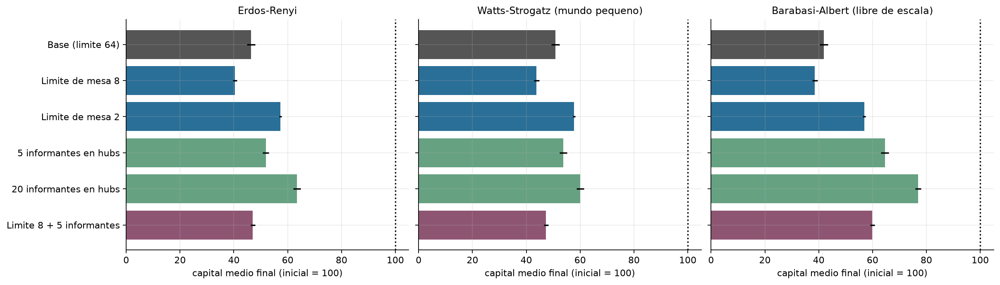

# 7. Conclusiones

1. **Ninguna estrategia vence a la casa.** La pérdida esperada por unidad apostada es $1-2p$ (2.7 % europea, 5.3 % americana) para todas las estrategias simuladas (Wald), y esta igualdad se observó numéricamente. Las estrategias solo modifican la varianza, la duración y la forma de la distribución: la Martingala cambia "perder poco y seguido" por "ganar poco y seguido y perder todo de golpe".
2. **El modelo analítico y la simulación coinciden** (error ≤ 0.012 en la ruina con 20 000 agentes; 96 % de puntos en el IC), también en la extensión con límite de mesa.
3. **La probabilidad de alcanzar una meta depende de cuánto se apuesta**, no de que la estrategia tenga ventaja: apostar más (Martingala, juego audaz) maximiza la probabilidad de la meta en juegos desfavorables, mientras en juegos favorables conviene la apuesta fraccionaria (Kelly; medio Kelly ofrece casi el mismo crecimiento con mucho menos riesgo).
4. **Las malas estrategias se propagan en redes** porque sus éxitos son visibles y sus fracasos no. La imitación duplicó la ruina frente a la ausencia de imitación. Los hubs e influencers que presumen solo ganancias aceleran el contagio; los informantes honestos en los hubs son la intervención más eficaz en redes libres de escala.
5. **Limitaciones.** (a) La ruleta no tiene memoria: la falacia del jugador es un sesgo cognitivo, no una propiedad del juego. (b) Rondas independientes, sin costos de transacción, pago 1:1 exacto, sin impuestos ni comisiones. (c) La dinámica de imitación (épocas de 25 rondas, probabilidad de imitar 0.3, regla "el mejor vecino", visibilidad solo de vivos) y el comportamiento de los informantes son supuestos de modelado; no se calibró con datos reales ni se exploró toda su sensibilidad. (d) Los resultados de red son promedios de 60–100 réplicas con $n=500$; las diferencias pequeñas entre topologías deben leerse con cautela. (e) Los agentes arruinados no reingresan.

# 8. Bibliografía

- Grinstead, C. M., & Snell, J. L. (1997). *Introduction to Probability*, cap. 11 (Cadenas de Markov absorbentes). American Mathematical Society.
- Feller, W. (1968). *An Introduction to Probability Theory and Its Applications*, vol. 1, cap. XIV (La ruina del jugador).
- Kelly, J. L. (1956). A new interpretation of information rate. *Bell System Technical Journal*, 35(4), 917–926.
- Dubins, L. E., & Savage, L. J. (1965). *How to Gamble If You Must*. McGraw-Hill.
- Thorp, E. O. (2006). The Kelly criterion in blackjack, sports betting and the stock market. En *Handbook of Asset and Liability Management*.
- Watts, D. J., & Strogatz, S. H. (1998). Collective dynamics of 'small-world' networks. *Nature*, 393, 440–442.
- Barabási, A.-L., & Albert, R. (1999). Emergence of scaling in random networks. *Science*, 286, 509–512.
- Erdős, P., & Rényi, A. (1959). On random graphs I. *Publ. Math. Debrecen*, 6, 290–297.
- Collet, P., Martínez, S., & San Martín, J. (2013). *Quasi-Stationary Distributions*. Springer.
- Hagberg, A., Schult, D., & Swart, P. (2008). Exploring network structure, dynamics, and function using NetworkX. *SciPy 2008*.
